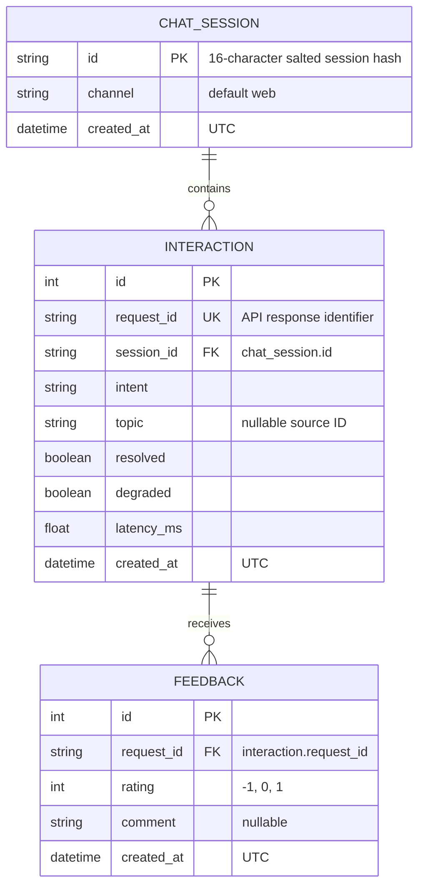

# Lab 5 design review

## Entity relationships

A session can contain zero or more interactions. Each interaction belongs to one
session. An interaction can receive zero or more feedback rows; each feedback row
refers to one interaction through the unique `request_id`, not `interaction.id`.
Repeated feedback for the same request is allowed by the supplied schema.

Migration 002 also creates a standalone `faq` table with `id` (PK), `question`,
`answer`, nullable `source_id`, `updated_at` and `updated_by`. It stores curated
content, not raw conversations. No SQL foreign key connects FAQ or `topic` to the
three core tables; the diagram does not invent such a relationship.

## Problems with the bad schema

The [completed worksheet](data_model.md) explains six issues: missing primary
keys, unnecessary personal content and indefinite retention, multiple ratings in
one text field, absent explicit relationships, ambiguous time/latency types, and
inconsistent intent labels. Each row distinguishes a current fix from a proposed
improvement or enforcement gap.

## Privacy and retention

Persist metadata needed by product features, a salted session hash and feedback.
Do not persist names, phone numbers, full user messages or answers. Free-text
feedback is allowed but can still contain personal details. Hashing is
pseudonymization; the 16-hex-character truncated hash is not collision-proof.

Proposed policy: raw chat content is never persisted; clear feedback comments
after 30 days; remove individual metadata and linked ratings within 90 days;
remove orphaned session rows afterwards. Delete child feedback before its parent
interaction, then delete sessions without interactions. These are proposals for
review, not retention behavior implemented by this task or the starter.

## Constraint boundaries

- Migration 001 declares a `CHECK (rating IN (-1, 0, 1))`; the SQLModel model has no
  equivalent CHECK. API input validation is not a replacement for database checks.
- The SQLite engine helper does not currently enable `PRAGMA foreign_keys=ON`.
  FK declarations describe intended integrity; verify runtime enforcement before
  claiming orphan rows are rejected by SQLite itself.
- `VARCHAR(500)` does not enforce a length bound in SQLite. The feedback API model
  validates length; direct SQL writes require additional validation if allowed.
- The intent column has no enum CHECK; valid vocabulary currently comes from the
  application. API `resolved` follows `intent != 'unknown'`; fallback/degraded is
  a separate property.
- A transaction commits a related batch together. Table declarations do not
  implement expiry, consent, encryption or automatic redaction.

These findings are review notes for TV4-TV6. TV7 does not modify their repository,
models, configuration, migrations or API implementation.
